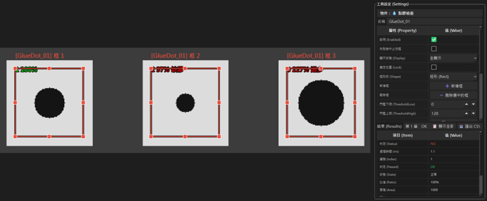
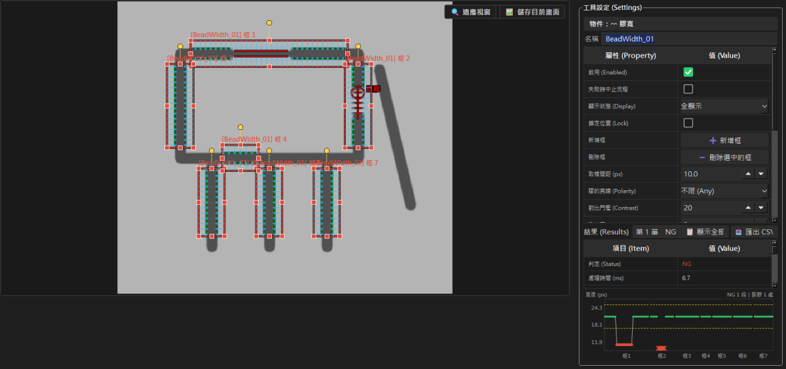
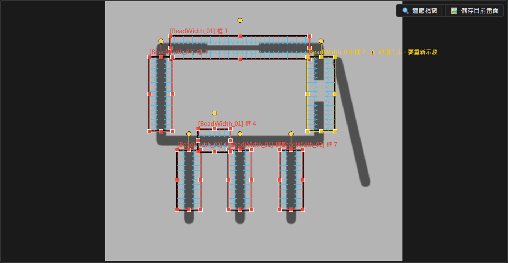
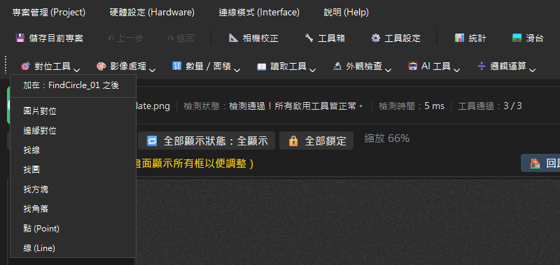
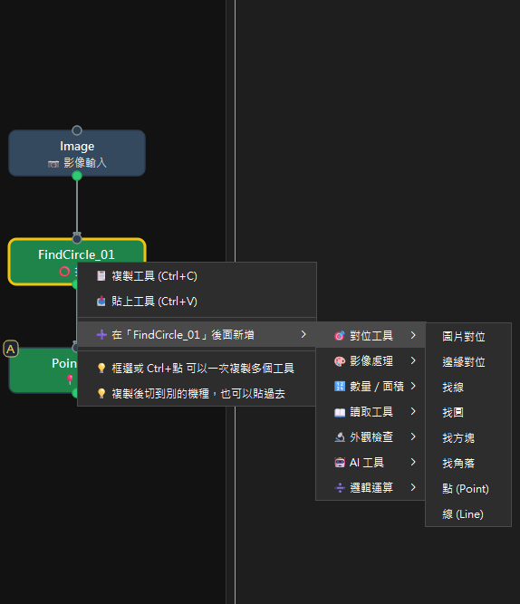
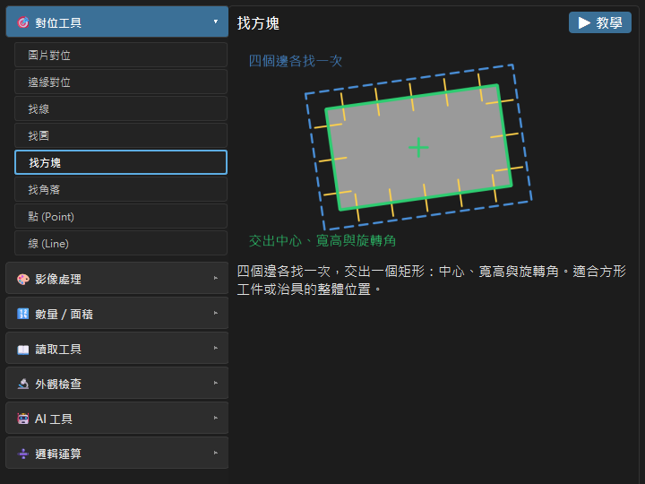
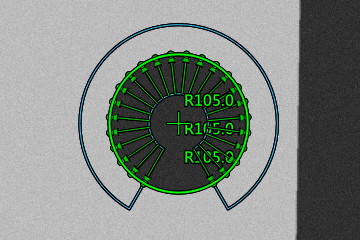

# 模組化 AOI — 更新紀錄

## 0.9.0 · 2026-10-29

- **新工具「💧 點膠檢查」**（外觀檢查分類）：一支工具可以放好幾個框，一個焊墊一個框。它量每個框裡的膠面積，跟示教良品的平均比：良品平均算 100%，少超過「可以少 −%」就判缺膠，多超過「可以多 ＋%」就判過多。只算面積、不數顆數，所以兩點膠連在一起或牽絲都不會誤判。外部讀 `states` 一次拿到每個框的狀態（0＝正常、1＝缺膠、2＝過多，例如 `0,0,1,0`），不用在 PLC 裡另外寫公式。框只算框內的膠，所以把框縮到「膠點＋可以接受的偏移」，點偏出框也會判缺膠。

  

  *點膠檢查三個框：框 1 膠量 100% 正常、框 2 膠點太小判缺膠、框 3 膠點太大判過多；右邊設定視窗有「新增框」「刪除選中的框」*
- **新工具「〰 膠寬」**（外觀檢查分類）：跟找方塊一樣拉框、轉框，但只有兩條長邊往中間掃——一個框罩住一段直的膠條，框拉成橫的或直的都可以。一支工具可以放好幾個框，每個框長度、角度各自不同，例如長方形四邊加三隻腳就放 7 個框；按「➕ 新增框」複製最後一個框，點框按 Delete 刪掉那一個。沿框的長邊每隔一段距離量一次膠寬（框上的箭頭就是量的位置），跟示教良品的平均比（每個框各自算 100%，−%／＋% 全部共用）：連續幾點太窄或太寬才判 NG，量不到膠的兩邊就是斷膠，一點就 NG。畫面上量到的膠邊依判定畫綠／紅、斷膠打紅叉，最差那一點畫圈標出寬度和百分比；結果面板下方多一張寬度曲線，調 −%／＋% 時不用重跑就看得到哪些點會超出，點曲線上的點畫面會跳過去。外部讀 `passed`、`min_width`、`max_width` 就夠，有校正時另有 mm。

  

  *膠寬用 7 個框罩住長方形四邊與三隻腳：框 1 中間一截變窄標紅、框 2 斷膠打叉；設定視窗下方的寬度曲線上，框 1 那段掉到下限虛線以下、框 2 標出斷膠*
- **點膠檢查、膠寬也有教學了**：在工具箱選到這兩個工具，按說明旁的「▶ 教學」，會用程式畫的示範圖一步一步帶：點膠教你一個焊墊放一個框、存良品、看缺膠和過多怎麼判；膠寬教你把框拉成橫的、直的，以及把框轉到斜的膠條上，再看變窄和斷膠怎麼判。
- **看得出是哪一個框還沒存良品**：點膠和膠寬的框一多，以前流程圖上只會整顆閃，不知道是哪一框的問題。現在缺良品樣本的那個框會變黃，旁邊直接寫原因：「未示教」（新加的框）、「改過大小，要重新示教」（存過，但之後把框拉大縮小了，舊樣本對不上），膠寬另外還有「樣本量不到寬度」（存了，但樣本上量不到膠邊，通常是極性或對比門檻要調）。存好樣本或把框改回原尺寸，黃色就消失。

  

  *膠寬的框 2 被拉大之後變成黃色，標籤後面寫著「改過大小，要重新示教」，其他框維持原本的顏色*
- **按執行後視窗不會再突然變很寬**：以前某些工具失敗時說明很長，上方資訊看板會把整個視窗撐寬。現在長訊息會換行往下長；NG 原因改成「[工具名] 一句話」的短版並標紅，完整說明在結果表，或把滑鼠停在看板上看。
- **畫面配色整理**：大塊的鮮豔顏色只留給 OK／NG 燈；藍色＝現在該按的（RUN、還沒示教時該按的那顆會藍色閃）；黃色只代表「有狀況但還不算失敗」（未存檔、未就緒）；其他都是灰階。流程圖選到的工具改成藍框，黃框只留給還沒準備好的工具。刪除、清除類的按鈕改成灰底紅字，每個對話框只有一顆主要按鈕。字的大小也統一了。
- **相機斷線時多一顆「🔌 重新連線相機」**：相機自動重連試到放棄時，主畫面才會出現這顆按鈕，按了重新連線；相機正常時看不到它。

## 0.8.0 · 2026-10-19

- **上一步／返回（Ctrl+Z／Ctrl+Y）**：拖框、改屬性、增刪工具、連線都能退回，工具列多了「↶ 上一步」「↷ 返回」兩顆，最多記 50 步。示教、加樣本、畫遮罩這類會寫進硬碟的動作做完之後，就退不到更早了；切機種會清空紀錄，REMOTE 下不能用。工具列上按不了的按鈕現在會變暗，一眼看得出來。
- **快捷工具列**：工具列下面多一排工具分類，點分類跳出選單、點工具就直接加進流程，不用開工具箱。選單最上面會寫新工具「加在哪個工具之後」。這排可以抓左邊的把手拖到別的位置（同一列、旁邊或拖出來浮著），位置會記住；在工具列上按右鍵可以重設位置或把它關掉。

  

  *快捷工具列：點「🎯 對位工具」跳出選單，最上面寫著新工具會加在哪個工具之後*
- **流程圖右鍵可以新增工具**：在流程圖的工具上按右鍵 →「➕ 在『某工具』後面新增」→ 選分類和工具，新工具就接在你按右鍵的那個工具後面，不會接錯位置。

  

  *在流程圖的 FindCircle_01 上按右鍵 →「在『FindCircle_01』後面新增」→ 選分類和工具*
- **工具箱改成單擊選定**：單擊工具會用亮框標起來並顯示說明；滑鼠滑過其他工具只是暫時預覽，移出工具清單就回到選定的那個。「▶ 教學」開的一定是選定的工具，不會再因為滑鼠經過別的工具而開錯。

  

  *工具箱裡單擊選定「找方塊」：按鈕亮框，右邊顯示它的說明與「▶ 教學」*
- **點／線工具接上來源後，畫面不再留一個沒用的框**：線的兩端都接到其他工具、或點的位置來自其他工具時，主畫面不會再畫它自己的框，也不會被框選或方向鍵移到。
- **結果文字不再疊在一起**：好幾個工具的結果文字擠在同一處時，會自動上下錯開；縮放或切換顯示時重新排。

  

  *三個找圓工具找同一個孔，結果文字自動上下錯開，不再疊成一團*

## 0.7.0 · 2026-10-08

- **自動全檢快很多**：改成多張圖同時檢測，約每秒 100 張（以前約 30 張）；畫面每 0.1 秒更新一次，不會因為一直重畫拖慢速度。
- **全檢可以只歸檔 NG**：開始全檢的確認視窗多一個「OK 也歸檔」勾選，預設勾著（跟以前一樣全部歸檔）；取消勾選就只留 NG 與錯誤的圖，報表照樣每張一列。
- **單張檢測變快**：流程裡互不相干的工具會同時跑，對位工具的角度搜尋也分給多個核心一起算；開角度範圍的機種一拍時間約剩一半到三分之一。檢測結果跟以前完全相同。
- **CSV 報表取消舊制「主要值」欄**：改成每個工具預設輸出它最常用的量測欄位，可在 CSV 欄位設定裡再加減。
- **可以複製機種**：連示教範本一起複製；工具也能在不同機種之間用 Ctrl+C／Ctrl+V 複製貼上。
- **修正工具列「工具設定／工具箱」連點兩下或視窗縮到最小後叫不出來**。

## 0.6.0 · 2026-10-06

- **支援單軸滑台（TOYO TC100／TS200）**：到「硬體設定 → 🛤 滑台設定」啟用後，工具列會多一顆「🛤 滑台」，打開的視窗左邊操作滑台（吋動、移到指定位置、回原點、警報重置），右邊設定目前機種的拍照點位（吋動到位按「記下目前位置」，或用起點／間距／顆數一次產生）。主畫面另有「🏠 回原點」與滑台狀態。**沒有滑台的機台不用動任何設定，畫面跟以前完全一樣。**
- **點位數量決定機種怎麼跑**：0 點跟以前一樣；1 點是「定點」，滑台不在那個位置就不檢測，外部 `VRUN` 回 `E14`；2 點以上是「整輪」，按一次檢測就依序移到每一點拍一張，每點各自判定、各自存檔（檔名加 `_P01`，CSV 多一欄「點位」），主畫面出現 ①②③ 結果燈號，點一下看那一顆。滑台出問題會立刻中止，沒跑到的點標「未檢」、不算進統計。
- **吋動按鈕可以設成前後 ▲▼**：滑台對人是前後走的機台，在滑台設定選「前後」，方向反了就勾「反向」。
- **沒有實體滑台也能試**：滑台設定選「虛擬滑台」，搭配虛擬相機就能把整輪流程跑一遍。
- **修正外部 `VRUN` 有機會拿到上一片的影像**：REMOTE 觸發模式下，偶爾會把上一次拍的那張當成這一次的結果回給 PLC。
- **第一次檢測不再卡**：載入機種時 AI 瑕疵檢測會先在背景暖機，第一拍從約 600 ms 降到約 200 ms。
- **修正部分新圖示顯示成方框**。

## 0.5.0 · 2026-10-05

- **AI 瑕疵檢測可用 Intel 內顯／NPU 加速**：有 Intel 內顯時自動使用，沒有就用 CPU（OpenVINO CPU 也比原本快）；結果面板多一行「運算硬體」，說明選單新增「AI 硬體加速檢查」可看目前用的是哪一種。
- **修正打包版 OCR 一直不能用**：以前安裝版少帶了 OCR 模型檔，OCR 工具永遠讀不到字。
- **空白鍵（腳踏開關）三種影像來源都能觸發檢測**。
- **對位與 AI 檢測變快**：快取範本讀檔與邊緣前處理、示教框尺寸。
- **相機校正教學補齊三種取點方式**：校正視窗的「▶ 教學」改成選單，除了「棋盤格自動」，
  新增「格點」（用 Blob 找圓點、填間距）與「拍尺」（填刻度間距、看紅線壓在刻度上）兩套，
  各有內建示範圖，一步步帶你做完一次校正。

## 0.4.0 · 2026-10-01

- **新手教學**：選到一個工具後，說明旁邊有「▶ 教學」。畫面會變暗，只亮「這一步要動的地方」，
  旁邊的泡泡講做什麼、為什麼；做完會自動往下一步。教學開在暫時的示範專案裡，
  結束後回到原本的專案，不會改到任何設定。每個工具各有一套。
- **教學更好用**：看結果的步驟畫面不變暗，可以看清楚檢查結果；「RUN」那步可以按「換一片」
  多試幾張（良品、不同瑕疵），試夠了再按「下一步」；泡泡上有「上一步」可以回頭看說明；
  要雙擊的地方旁邊會有滑鼠點兩下的小動畫。
- **相機校正教學**：校正視窗右上角新增「▶ 教學」，用內建的棋盤格示範圖，
  一步步帶你做完新增校正、填板子規格、偵測角點、計算校正、看結果。
- **工具箱改成「雙擊」才加進流程**：避免單擊誤加。
- **找圓預設留缺口**：新加進流程的找圓，開口角度預設是 300°（下方留缺口），
  一看就知道扇形可以調；整圈都看得到時把「開口角度」拉到 360°。已存在的專案不受影響。
- **主畫面底部常用項目跟著選到的工具換**；順序／重複檢測收進「⋯」；
  AI 的「自動建議」改叫「學習」並放到底部；「適應視窗」「儲存目前畫面」浮到畫布右上角；
  運算／文字工具還沒設好時，會閃「式子」「文字」那一格提醒。
- **修正**：換專案後腳踏開關失效；AI 學習時良品與不良品分數相近，門檻有時挑到最鈍的。

## 0.3.0 · 2026-09-29

- **Windows 淺色模式下畫面不再一塊黑一塊白**：以前電腦設成淺色模式（Windows 預設）時，
  部分對話框、清單、輸入框會變成白底。現在整個程式固定深色，不看 Windows 的設定。
- **安裝包附上 AI 模型**：第一次安裝的 zip 裡已經有 `models\dinov2_vits14.onnx`，
  解壓就能用「AI 瑕疵檢測」，不必再自己下載。

## 0.2.0 · 2026-09-27

- **虛擬相機**：沒接相機也能測 PLC／手臂對接。在「硬體設定」按「虛擬相機」選一個圖片資料夾，
  它就會當成一台相機出現在清單裡；機種選它、維持相機模式，每次 `VRUN` 照檔名順序換下一張，
  放完從頭。放一張可以測通訊，OK、NG 各放幾張就能測收到 NG 時的動作。
  狀態燈是黃色並寫著「虛擬相機（不是真相機）」，量產時看到就知道選錯了。

- **對位可以示教多個範本**：同一個工件有好幾個版本（外觀不同）時，在圖片對位或邊緣對位的
  屬性裡按「＋ 新增範本」，每個版本示教一個，任一個找到就算找到，後面的檢查共用一套，
  不必再做「A 找不到改走 B」兩個對位工具。預設先試上一次找到的範本，量產時跟單一範本
  一樣快；要準確分辨是哪個版本，勾「全部比較取最高分」。結果表多一欄「範本」。
- **屬性裡直接看範本長什麼樣子**：對位工具多一格「範本預覽」，顯示目前編輯中的範本，
  遮罩塗掉的地方會變暗；滑鼠停在圖上看原尺寸。不用再開「塗改遮罩」才看得到。
- **Tray 盤可以指定從哪一側開始拿**：對位工具多一個「挑選順序」，可選上→下、下→上、
  左→右、右→左（預設仍是分數高到低）。選了方向就從**整個畫面**挑最靠那一側的，
  不再是「找到的幾個裡面」最靠那一側的；搜尋數量設 1 就能直接拿到最上面那顆。
  找 99 顆也只比找 1 顆多約 0.1 秒。另外找多個目標時少算一次比對，找 5 個快了將近一倍。
- **主畫面看得出是哪一顆**：對位找到多個時，排第 1 的（下游跟隨、手臂先拿的）是亮綠粗框，
  其他是淺綠細框；在結果區的下拉改選第幾筆，主畫面就改亮那一顆。
- **分身跟隨：下游工具對每一顆都檢查一次**：對位工具勾「分身跟隨」後，跟隨它的工具
  （例如判斷正反面的兩個找線）會對找到的每一顆各跑一次（最多 20 顆）。外部用
  `找線[3].passed` 讀第 3 顆，`對位.first_pass` 直接知道第一顆全過的是哪顆。這些下游工具
  不算進總判定，要拿哪一顆由手臂程式決定；對位本身沒找到仍是 NG。點選這些工具時，
  結果區可以切換看第幾顆，主畫面同步亮那一顆。

## 0.1.0 · 2026-09-26

第一版。以下是這套程式現在做得到的事。

- **流程圖式的檢測配方**：拖節點、拉連線就是一條檢測流程，不用寫程式。
  以「機種」為單位存檔，換產品就換機種。
- **對位**：圖片對位與邊緣對位兩種，後面的框跟著工件一起位移旋轉。
- **找形狀**：找線、找圓、找方塊、找角落；點與線可以再組出距離、角度、交點。
- **檢查與計數**：Blob、週期計數、灰階檢查（含「最光滑處」）、條碼／QR、OCR。
- **運算與文字**：用式子把各工具的結果算在一起（可以直接當總判定），
  或在畫面上顯示自訂的文字與數值。
- **AI 瑕疵檢測**：只餵良品就能學，會把可疑的地方圈出來；射出流痕會放行。
- **相機校正**：Pixel 換算成 mm，量測結果直接標實際尺寸。
- **門檻調校視窗**：用直方圖看每一張的分數落在哪，不必憑感覺調數字。
- **外部呼叫介面**：PC 或 PLC 可以用 TCP 叫它檢測、改參數、取結果。
  安裝包附一支「AOI對接測試工具」，設備商不裝 Python 就能先試通。
- **首件檢測與統計**：腳踏開關觸發、結果存檔、重複檢測的散佈統計。
  存哪些片（全部／只存 NG）、存原圖或疊加圖、CSV 要哪些欄位都可以自己選。
- **自動更新**：有新版會提示，按一下就換好，換不成功會自動退回原本的版本。
